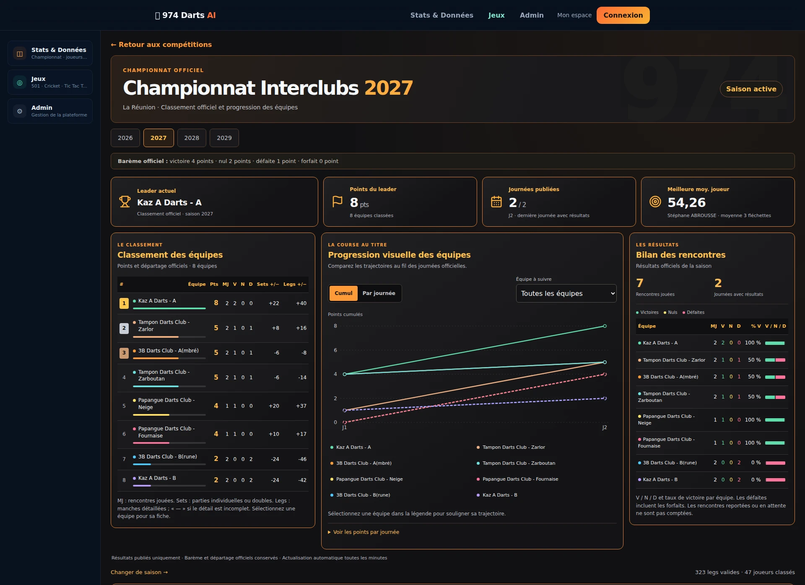

# Dashboard Interclubs — inspiration Power BI

Le championnat utilise désormais un bandeau de KPI, un classement avec barres de points et podium, une progression centrale et un bilan compact des rencontres. Le double affichage du classement a été supprimé. Les pages des autres compétitions conservent leur thème.

## Composants

- `app/frontend/components/stats/ChampionshipCharts.tsx` : résumé, classement et bilan ; actualisation de la saison active toutes les 60 secondes et au retour sur l’onglet.
- `app/frontend/components/stats/ChampionshipProgression.tsx` : graphique Recharts, cumul / journée, sélection par liste ou légende, infobulle et tableau accessible.
- `app/frontend/components/stats/ChampionshipCharts.module.css` : thème anthracite/orange, grille adaptée à la largeur et tableaux défilants.
- `app/frontend/app/championships/[season]/page.tsx` : intégration et navigation entre les saisons du catalogue existant.
- `dashboard.css`, `loading.tsx`, `loading.module.css` dans cette route : habillage local et chargement.

## Fiabilité

Le tableau conserve exactement l’ordre, les rangs et les points de `standings`. Les deux modes du graphique lisent respectivement `round_history[].teams[].cumulative_points` et `points`. Une valeur journalière absente reste `null`, avec une interruption de la courbe et une mention explicite. Sélectionner une équipe conserve les autres trajectoires visibles. Le détail accessible garde toutes les équipes et journées pour permettre le contrôle des chiffres.

Les sets et les legs ont des colonnes distinctes. L’écart de legs est masqué si `detail_complete` est faux. Le taux V/MJ utilise les résultats officiels de chaque équipe ; le total de rencontres divise la somme des MJ par deux. Le KPI de moyenne désigne la meilleure **moyenne individuelle 3 fléchettes** fournie par les leaders, sans inventer une moyenne collective.

Aucune modification du backend, des règles de points, des sources N01/Nakka, des statuts de publication ou des résultats historiques. Aucun nouvel accès aux tables ni migration. Le serveur continue à lire les données sans cache. Les dates suivent le fuseau de La Réunion.

La prochaine journée n’est affichée que si le calendrier fourni contient une date présente ou future. Le contrat actuel de cette page ne fournit ni bilan domicile/extérieur ni volumes de gros scores par équipe : ces blocs restent absents. Les plages 100–119 / 120–139 / 140–179 / 180 et les compteurs cumulatifs existants sont inchangés.

## Captures

Les captures montrent un rendu local du build de production, alimenté par un instantané public lu le 15 octobre 2026 sur `/championships/2027` et `/api/ranking` : huit équipes, deux journées avec résultats et sept rencontres publiées. Les leaders et les compteurs proviennent également de la page publique. Les métadonnées de l’aperçu local reprennent les deux journées publiées visibles ; les métadonnées complètes restent fournies par l’API en utilisation normale. Ce rendu local ne constitue pas un déploiement et ne reprend aucun chiffre de la référence Power BI 2026.



[Capture mobile, largeur 390 px](mobile.webp)

## Vérifications

- `npm --prefix app/frontend test` : réussi ; 44 avertissements de lint préexistants, aucune erreur. Lint ciblé des composants modifiés : aucun avertissement.
- `npm --prefix app/frontend run build` : réussi avec Next.js 16.3.8.
- `PYTHONPATH=app/backend python -m pytest app/backend/tests/test_championship_charts.py app/backend/tests/test_ranking_rules.py app/backend/tests/test_interclub_publication.py app/backend/tests/test_interclub_j2_correction.py -q` : 18 tests réussis.
- Tests Chromium sur le build : valeurs et ordre du classement, V/N/D et taux, lien équipe, cumul égal au classement, sélection sans suppression des courbes, infobulles, mode journalier sans faux zéros, saisons vide / une journée / 14 journées, largeurs 320, 390, 430, 820, 1440 et 1920 px sans débordement de page ; navigation entre les saisons et actualisation automatique conservant le mode et la sélection. Exécutés avec l’instantané public puis les fixtures jetables existantes.

Reproduire les tests navigateur sans accès aux données de production :

```sh
npm --prefix app/frontend ci
npm --prefix tests/workflow ci
python -m pip install -r app/backend/requirements.txt
npm --prefix app/frontend run build
cd tests/workflow
npx playwright install chromium
npm run test:championship:browser
```

`CHROMIUM_EXECUTABLE_PATH` permet de choisir un navigateur déjà installé ; `CHAMPIONSHIP_QA_OUTPUT` permet de choisir le dossier de captures et journaux. Le runner utilise uniquement des fixtures locales et ne publie aucun résultat.

Aucune fusion et aucun déploiement en production : validation visuelle requise avant toute mise en production.
